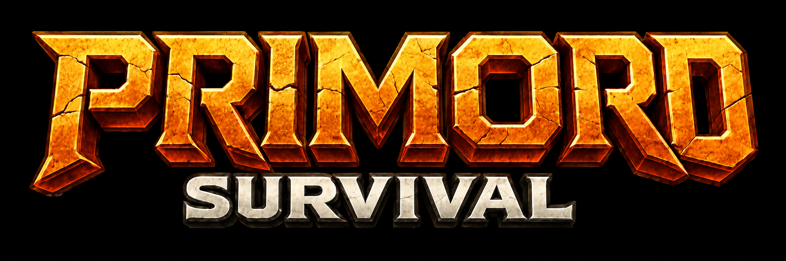

# Primord Survival — apresentação



**Conheça o mapa. Prepare sua próxima vida.**

Apresentação visual do Primord Survival para The Isle, com funcionalidades, telas, atalhos e contato. Material de divulgação para quem quer conhecer o projeto.


## O que você encontra

- **Minimapa e mapa F9:** acompanhe a posição, amplie a região e ajuste a visualização.
- **Marcações:** crie pontos azuis com o botão direito no mapa ampliado e acompanhe a direção no minimapa.
- **Status e Prime:** consulte crescimento, vida, vigor, comida, sede e o checklist Prime do Primord.
- **Dinos e builds:** catálogo com busca, filtros de dieta e estilos de Sobrevivência, PvP e PvP + Sobrevivência.
- **Mutações:** efeitos, disponibilidade e bônus Base, Entomb 1 e Entomb 2.
- **Resumo F4:** consulta compacta da build selecionada no guia.

O guia serve para consulta e planejamento; selecionar uma build não altera o dinossauro no jogo. O resumo F4 usa sua seleção manual e o slot 4 depende de Prime.

## Explore a apresentação

Abra [index.html](index.html) no navegador. A página funciona diretamente da pasta, sem instalar dependências, e inclui:

- Oito telas com explicações e ampliação de imagens.
- Apresentação automática opcional, com pausa e troca de tela a cada 7 segundos.
- Layout para computador e celular, com animações que respeitam a preferência de redução de movimento.
- Botão para copiar o Discord e link do Instagram.

A imagem `referencia-builds.png` está identificada como conceito visual; não representa a interface atual do aplicativo. Há também [legendas prontas para divulgação](TEXTOS-PARA-DIVULGACAO.md).

## Contato

- **Discord:** `luccosta` — adicione pelo nome de usuário.
- **Instagram:** [@luccosta.ig](https://www.instagram.com/luccosta.ig/).

Para dúvidas, informações e acesso, me chama no Discord ou no direct.

Disponível para Windows. Instalar e atualizar não exige key; utilizar exige licença válida. O HUD depende do painel Primord e de um dino ativo.

## Sobre este repositório

Este repositório contém apenas a apresentação estática, imagens e textos de divulgação. O aplicativo, instaladores, banco de licenças e dados de contas não fazem parte dele. Não há backend, formulário ou coleta de dados nesta página.

Para publicar em uma hospedagem estática, mantenha `index.html`, `styles.css`, `app.js`, `.nojekyll` e a pasta `assets` na raiz. No GitHub Pages, use a branch `main`, pasta `/ (root)`.

Para revisar por HTTP local, opcionalmente execute nesta pasta:

```powershell
python -m http.server 8090 --bind 127.0.0.1
```

Abra `http://127.0.0.1:8090`. Encerre com `Ctrl+C`.
