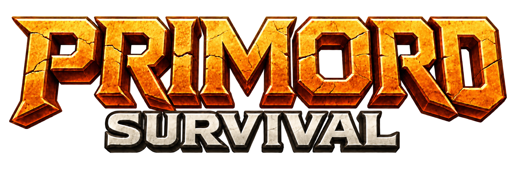
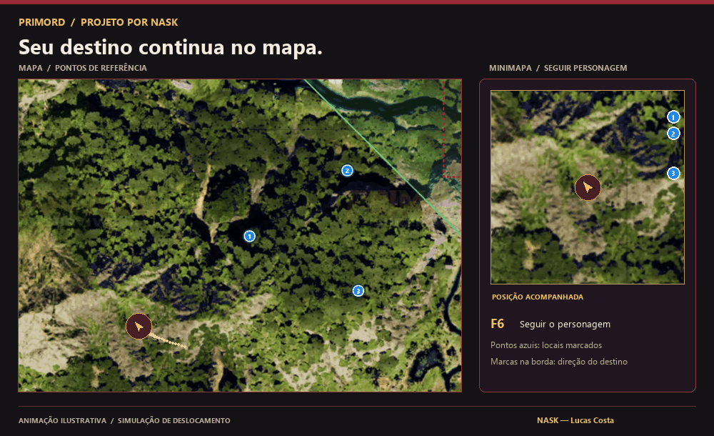
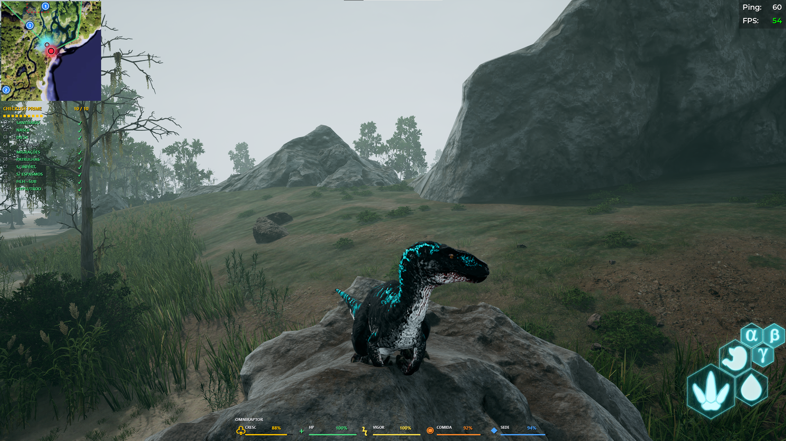
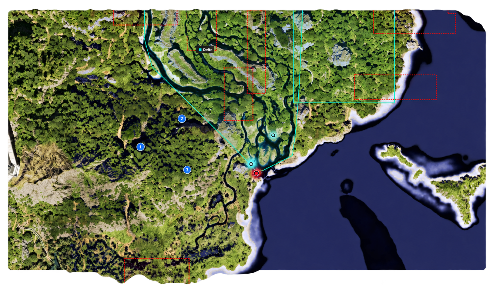
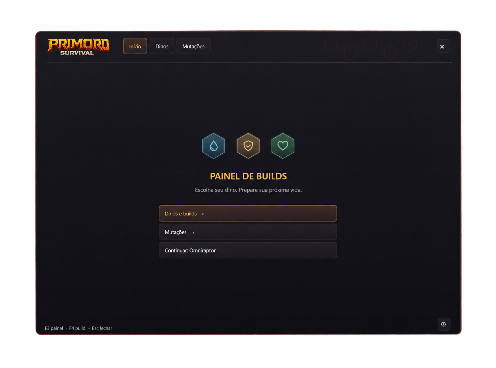
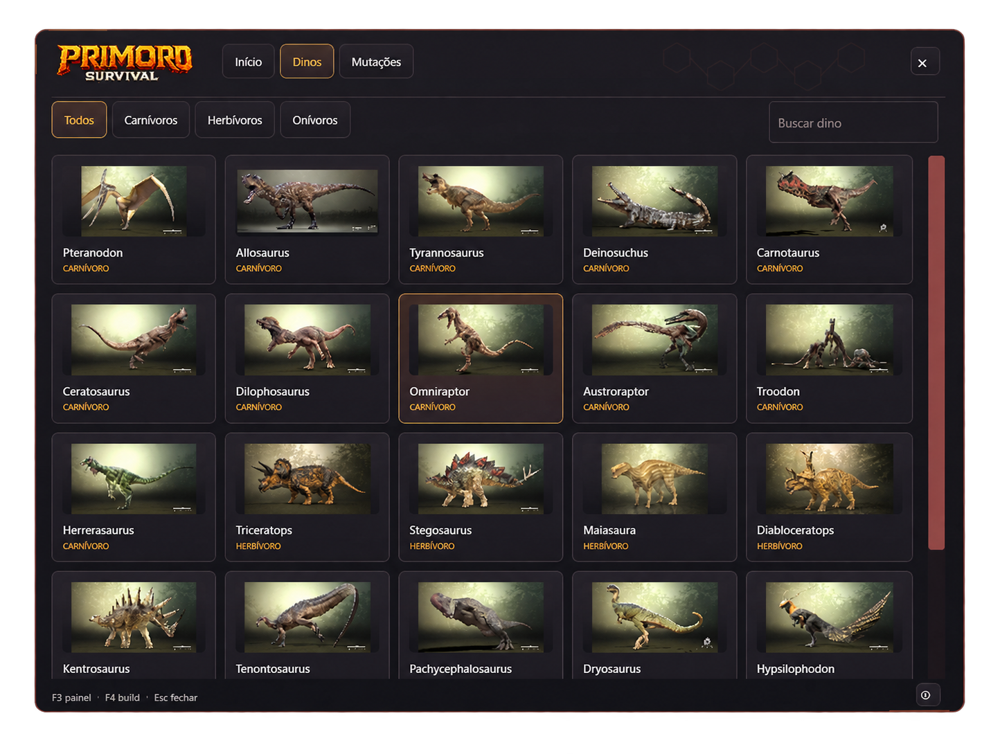
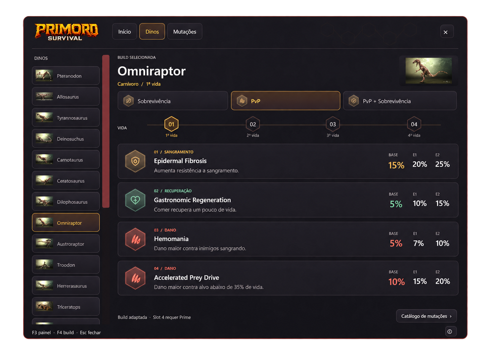
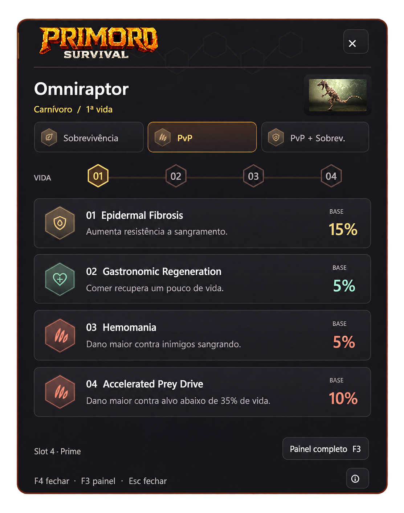
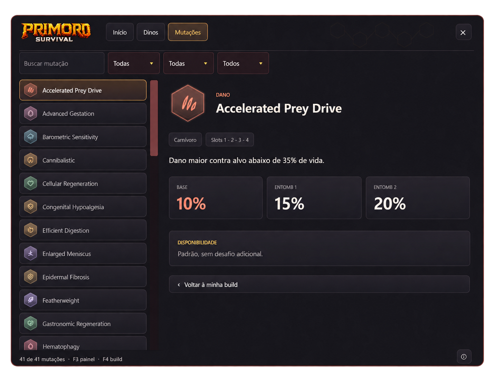
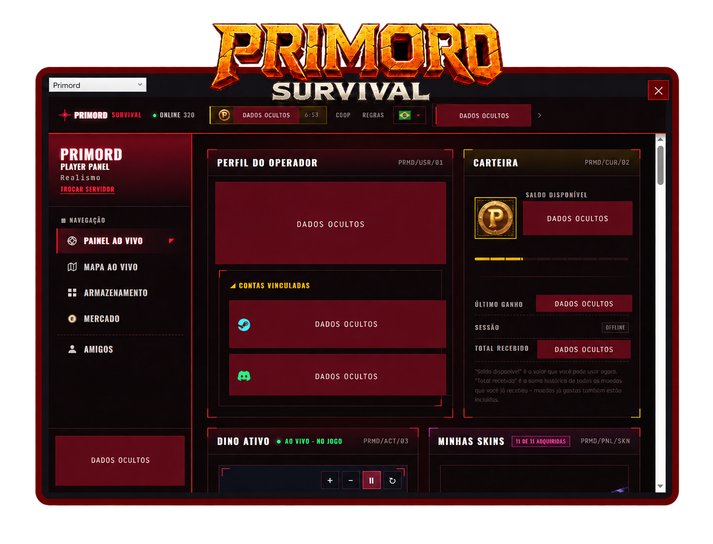

  

<h1 align="center">Conheça o mapa. Prepare sua próxima vida.</h1>

Minimapa, marcações, status, builds e mutações para acompanhar sua jornada em <strong>The Isle</strong>.

<strong>Desenvolvido por NASK — Lucas Costa</strong> Apresentação preparada para a equipe Primord.

<strong>Discord: luccosta</strong> · <a href="https://www.instagram.com/luccosta.ig/">Instagram: @luccosta.ig</a>

---

## Seu próximo destino começa no minimapa

Tenha uma referência da região enquanto joga. Amplie o mapa, marque locais importantes e acompanhe a direção do próximo destino sem precisar decorar o caminho.

*Animação ilustrativa montada sobre o mapa fornecido: simula o deslocamento do personagem e o minimapa seguindo sua posição. Não é uma gravação de uma partida.*

| Recurso | Como ajuda na jornada |
| --- | --- |
| **Minimapa** | Acompanhe sua posição e mantenha os pontos de referência por perto. |
| **Mapa ampliado** | Use F9 para reconhecer melhor a região e escolher os próximos destinos. |
| **Marcações azuis** | Guarde locais importantes e veja a direção deles na borda do minimapa. |
| **Status e Prime** | Consulte os atributos do dino e acompanhe o checklist Prime do Primord. |
| **Dinos e builds** | Explore espécies e consulte sugestões para diferentes estilos de jogo. |
| **Mutações** | Veja efeitos, disponibilidade e bônus antes de planejar sua build. |

---

## Informações durante o jogo

**A visão completa da partida.** Esta captura foi mantida integralmente para mostrar como o HUD fica sobre o jogo.

O minimapa e o checklist ficam à esquerda. Na base da tela, acompanhe **crescimento, HP, vigor, comida e sede** em uma faixa compacta.

O HUD depende do painel Primord e de um dino ativo. Pelo menu do aplicativo, você pode ajustar a visualização e ocultar as partes que não quer exibir.

## Mapa e marcações

**Um ponto no mapa. Um destino na sua jornada.**

1. Pressione **F9** para abrir o mapa ampliado.
2. Clique com o **botão direito** no local para criar uma marca azul.
3. Para apagar, clique com o **botão direito na bolinha**.
4. Use **F9 ou Esc** para retornar ao minimapa.

Quando uma marca está fora da visão pequena, ela aparece na **borda do minimapa**, indicando a direção do destino. Use **F6** para seguir o personagem.

## Menu inicial

**Abra o guia. Escolha o que quer consultar.**

Com **F3**, você abre o painel completo. A tela inicial dá acesso ao catálogo de dinos, às builds e às mutações, além da opção de continuar sua seleção anterior.

## Catálogo de dinossauros

**Encontre o dino que combina com sua próxima jornada.**

- Explore as espécies pelas imagens.
- Busque um dino pelo nome.
- Filtre por **carnívoros, herbívoros ou onívoros**.
- Selecione uma espécie para consultar suas builds.

## Builds para diferentes estilos

**Sobrevivência, PvP ou um pouco dos dois.**

Escolha o dino, o estilo e a vida para consultar a composição sugerida. O painel organiza as mutações por efeito e apresenta os bônus **Base, Entomb 1 e Entomb 2** para comparação.

O guia é uma ferramenta de consulta: selecionar uma build não aplica as mutações ao dinossauro no jogo. O **slot 4 depende de Prime**.

## Sua build a um F4 de distância

**Uma consulta rápida para voltar à jornada.**

  

O **F4** abre um resumo compacto com o dino, estilo e vida selecionados no guia. Veja as mutações, seus efeitos e os bônus base sem abrir o catálogo completo. **F3** retorna ao painel completo e **Esc** fecha o guia.

O resumo usa sua seleção manual no painel; não identifica automaticamente a espécie do jogo.

## Entenda suas mutações

**Mais informação antes de cada escolha.**

Use a busca e os filtros para encontrar uma mutação. Consulte o efeito, a disponibilidade e os bônus por etapa para planejar a evolução da sua build. A tela apresentada mostra um catálogo com **41 mutações**.

## Painel Primord

**O portal também fica por perto.**

Acesse o portal Primord em uma janela própria, com as opções de navegação do painel. O conteúdo e a disponibilidade das informações dependem do portal.

*Imagem preparada a partir da captura fornecida, com informações da conta ocultadas para divulgação.*

---

## Os principais atalhos

| Tecla | Função |
| --- | --- |
| **F3** | Abrir o menu completo de dinos, builds e mutações. |
| **F4** | Consultar o resumo da build selecionada. |
| **F9** | Ampliar ou restaurar o mapa. |
| **F6** | Seguir o personagem no mapa. |
| **F8** | Mostrar ou esconder o HUD. |
| **Esc** | Fechar o guia ou retornar ao minimapa. |
| **Botão direito no F9** | Criar uma marca ou apagar a bolinha selecionada. |

## Curtiu o projeto? Fale comigo.

Para conversar sobre o projeto, tirar dúvidas ou conhecer melhor a proposta, fale com **NASK — Lucas Costa**:

| Discord | Instagram |
| --- | --- |
| **luccosta** — adicione pelo nome de usuário. | **[@luccosta.ig](https://www.instagram.com/luccosta.ig/)** — me chama no direct. |

Disponível para **Windows**. Instalar e atualizar não exige key; utilizar exige uma licença válida.

<strong>NASK — Lucas Costa</strong> Desenvolvimento e apresentação do projeto. © 2026 NASK — Lucas Costa. Todos os direitos reservados.

